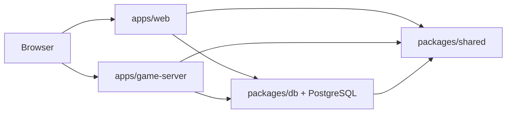

# BK Derby

BK Derby is a live horse-racing simulation played with free points. The server schedules each race, runs the simulation, decides the finish order, and settles every ticket. The browser renders what the server broadcasts.

Points are free and have no cash value. There is no way to deposit, withdraw, exchange, or transfer them.

The repository and its workspace packages are named `bk-games` (`@bk-games/db`, `@bk-games/shared`, `@bk-games/game-engine`).

## What This Project Is

BK Derby is a portfolio-scale full-stack project focused on real-time systems and point-wallet correctness.

- Free points only
- No cash deposits or withdrawals
- No point exchange, point transfer, or marketplace
- Fictional horses only
- Authenticated accounts with Better Auth
- Wallet and ledger-backed point movement
- Server-authoritative race state and settlement
- Socket.IO race updates for the live screen

The core loop is simple: open the public home page and watch races as a guest, sign in to claim the daily free points, issue a ticket for the next race while its ticket window is open, watch the race live, and receive a private wallet update when the ticket is accepted and again if it pays out or the race is cancelled.

## Screenshots

| Account Access |
|---|
|  |

| BK Derby |
|---|
|  |

Screenshots are local development snapshots.

## Product Surfaces

| Route | Purpose | Auth |
|---|---|---|
| `/` | Home page: entry to BK Derby plus a guest/login-aware daily reward and wallet panel | Public; login required to claim |
| `/auth` | Sign in and sign up | Public |
| `/lobby` | Legacy redirect to `/` | Public |
| `/racing/bk-derby` | BK Derby screen: live track, ticket window, race history, horse records, and personal ticket history | Public to watch; login required to issue a ticket |

## Tech Stack

| Area | Stack |
|---|---|
| Web | Next.js 16, React 19, TypeScript, App Router, React Compiler, Cache Components |
| Styling and UI | Tailwind CSS 4, Base UI, shadcn/ui primitives |
| Realtime server | NestJS 11, Socket.IO 4 |
| Database | PostgreSQL 17 locally, Drizzle ORM, node-postgres |
| Auth | Better Auth (email and password), JOSE-issued short-lived game tokens |
| Race simulation | Deterministic seeded TypeScript model in `packages/shared` |
| Monorepo | pnpm 10 workspaces, Turbo 2 |
| Local infra | Docker Compose PostgreSQL |
| Quality gates | TypeScript typecheck, ESLint, Jest game-server tests, Vitest and Node test-runner package tests, PostgreSQL smoke scripts |

## BK Derby Features

- One shared race table (`main`) with six fictional horses. Everyone connected sees the same race.
- A repeating 120-second cycle with the seeded table settings: a 40-second ticket window, a 20-second lock before the start, then 60 seconds for the race and result display (the race runs for up to 50 seconds).
- Guests can watch live. Issuing a ticket requires a signed-in account.
- Seven ticket types, listed below. A user can hold several tickets on the same race.
- Stake limits of 100 to 6,000 points per ticket, re-validated on the server against the wallet's available balance.
- Fixed multipliers. Each multiplier is the inverse of the ticket's chance in an evenly matched field, times a 90% payout rate. It is stored on the ticket as an integer numerator and denominator when the ticket is accepted, and payouts use integer math.
- Recent race history and per-horse records on the race screen, plus a personal ticket history for the signed-in user. The history API can also filter by Korea-time date.
- The race clock pauses while nobody is watching and no tickets are live, and resumes when a viewer joins.

| Ticket | Picks | Wins when | Multiplier with six horses |
|---|---|---|---|
| `WIN` | 1 | The horse finishes first | 5.4x |
| `PLACE` | 1 | The horse finishes in the top two (top three in a field of eight or more) | 2.7x |
| `QUINELLA` | 2 | Both horses finish in the top two, in either order | 13.5x |
| `EXACTA` | 2 | The horses finish first and second in the chosen order | 27x |
| `QUINELLA_PLACE` | 2 | Both horses finish in the top three | 4.5x |
| `TRIO` | 3 | The three horses fill the top three, in any order | 18x |
| `TRIFECTA` | 3 | The horses finish first, second, and third in the chosen order | 108x |

## Planned Work

- Continue production hardening for deployment, observability, and operational recovery.
- Persist race tick history. The `racing_ticks` table exists, but the runtime does not write to it yet.
- Add runtime schema validation for shared HTTP and Socket.IO payloads. `packages/shared` currently provides compile-time TypeScript contracts, while the gateway performs runtime validation manually.
- Add automated web and shared-package test suites. Their current `test` scripts are placeholders; most database behavior is verified through PostgreSQL-backed smoke scripts.

## Architecture

```text
apps/web
  Next.js app for the public home, auth, the BK Derby screen, and web-facing API routes.

apps/game-server
  NestJS + Socket.IO runtime for the race schedule, phase timers, tick broadcast, ticket commands, and settlement hand-off.

packages/shared
  Socket event names, payload types, room helpers, and the deterministic race simulation used for final results.

packages/db
  Drizzle schema, wallet ledger helpers, race scheduling, ticket placement, settlement, history queries, seed scripts, and smoke scripts.

packages/game-engine
  Framework-free TypeScript game-logic modules with Vitest tests. The live race does not import this package.
```

Runtime dependencies on the race path:



The web app owns the Better Auth browser session. For ticket commands, the web app issues a short-lived game token from an authenticated session, and the game server validates that token before it accepts the command.

## Real-Time Model

The game server is the source of truth for the race schedule, phases, tick positions, accepted tickets, finish order, and settlement. Clients render state and send commands, but they do not decide outcomes.

BK Derby uses:

- `POST /api/game-token` from the web app
- Socket.IO namespace `/racing`
- Client commands `table:join` (guests allowed) and `bet:place` (game token and `commandId` required)
- `table:state`: the full table snapshot, including phase, timing, stake limits, entries, the current race, and a `version` counter
- `table:event`: the event stream, with `RACE_SCHEDULED`, `BET_PLACED`, `PRESTART_TICK`, `RACE_STARTED`, `RACE_TICK`, and `RACE_SETTLED`, plus viewer join and disconnect notices
- `wallet:updated`: a private event sent only to the affected user's room, with reason `BET_PLACED`, `PAYOUT`, or `CANCEL_REFUND`
- `error`: a typed error code and message

A race moves through `WAITING`, `BETTING`, `LOCKING_BETS`, `RUNNING`, `SETTLED`, and `ROUND_END`, or ends in `CANCELLED`.

1. **Schedule.** `packages/db/src/racing-scheduler.ts` creates the next race row with its entries and derives the ticket-window open and close times from the table timing.
2. **Ticket window.** `bet:place` is parsed by the gateway and handed to `placeRacingBet` in `packages/db/src/racing-betting.ts`. One transaction locks the race and table rows, re-checks the phase and window against server time, locks the wallet, enforces the stake limits, debits the wallet, appends the `BET` ledger entry, and inserts the ticket with its selections.
3. **Countdown.** In the last five seconds before the scheduled start, the server emits `PRESTART_TICK` every 100 ms with the server time and the remaining milliseconds, so clients can align the start to the server clock.
4. **Race.** While the race is `RUNNING`, the server computes each entry's progress and rank from the elapsed server time on every tick interval (100 ms on the main table) and broadcasts a `RACE_TICK`. Positions are a function of the seed and the elapsed time, so a viewer who joins or reconnects mid-race picks up from the next tick.
5. **Settlement.** `packages/db/src/racing-runner.ts` computes the final order with `packages/shared/src/racing-simulation.ts` and calls `settleRacingRace`. One transaction writes the final ranks, marks each ticket won or lost, credits a `PAYOUT` ledger entry for each winning ticket, and marks the race settled. If the simulation cannot produce a full finish order inside the race window, the race is cancelled and every ticket is refunded with a `CANCEL_REFUND` entry.
6. **Result.** The result stays on screen until the round ends, and the next race is scheduled.

The simulation is deterministic. Its seed is derived from the race id and race number and is stored on the race row when the race starts. The tick broadcast in `apps/game-server/src/racing/racing-race-tick.ts` and the settlement use the same model, seed, and timing inputs.

Phase timers and the tick loop run only while the table has viewers or live tickets. A schedule sync runs every 60 seconds as a backstop. If the socket is not connected, the web client falls back to polling `GET /racing/tables`.

The game server also exposes read-only HTTP endpoints:

| Endpoint | Purpose |
|---|---|
| `GET /racing/tables` | Table summary with the current race |
| `GET /racing/races` | Settled race results; optional `tableId`, `date` (`YYYY-MM-DD`, Korea time), and `limit` (default 50, max 100) |
| `GET /racing/horses/stats` | Per-horse starts, wins, top-two and top-three rates, average rank, and recent results over the same window |
| `GET /racing/bets` | The signed-in user's ticket history; requires `Authorization: Bearer <game token>`; optional `tableId` and `limit` (default 20, max 100) |

The shared socket package currently provides compile-time TypeScript contracts rather than runtime schemas. The gateway performs its own runtime parsing and validation at the network boundary.

## Wallet And Points

The wallet system is intentionally conservative:

- Daily rewards create free points for play: 1,000 points per Korea-time day.
- Wallet updates and point ledger inserts happen atomically in one database transaction.
- Ticket placement and settlement happen inside backend-controlled transactions.
- Accepted point-changing commands use idempotency keys.
- Cancellation refunds use the stake stored on the ticket and are safe to retry.
- Private wallet updates are sent only to the affected user.
- Broadcast table state does not expose private wallet balances.

Application code treats point ledger rows as append-only. PostgreSQL unique and check constraints protect idempotency, non-negative balances, and ledger balance math, but the database does not currently use a ledger-specific trigger or restricted role to prohibit every `UPDATE` or `DELETE`.

This keeps race animation and UX separate from point correctness. UI can be polished freely while the backend remains authoritative.

## Local Development

Install dependencies:

```bash
corepack pnpm install
```

Create a `.env` file at the repository root from `.env.example` and replace the placeholder secrets.

Start local PostgreSQL and prepare data:

```bash
docker compose up -d postgres
corepack pnpm db:migrate
corepack pnpm --filter @bk-games/db seed:racing-main
```

Run the apps:

```bash
corepack pnpm --filter web dev
corepack pnpm --filter game-server dev
```

Default local URLs:

| Service | URL |
|---|---|
| Web | `http://localhost:3000` |
| Game server | `http://localhost:4000` |

Useful checks:

```bash
corepack pnpm typecheck
corepack pnpm lint
corepack pnpm test
corepack pnpm --filter game-server test
corepack pnpm --filter @bk-games/db smoke:wallet
corepack pnpm --filter @bk-games/db smoke:daily-reward
corepack pnpm --filter @bk-games/db smoke:racing-scheduler
corepack pnpm --filter @bk-games/db smoke:racing-runner
corepack pnpm --filter @bk-games/db smoke:racing-wallet
corepack pnpm --filter game-server smoke:racing-cycle
```

Automated tests run in `apps/game-server` (Jest), `packages/game-engine` (Vitest), and `packages/db` (Node test runner). The web and shared packages have typecheck coverage, while their package-level `test` scripts do not yet run unit tests. Database smoke scripts require a configured PostgreSQL instance and matching schema state. `smoke:racing-cycle` also needs a running game server and follows one live race from ticket to settlement. It sends no game token, so the target server must be started with `GAME_SOCKET_DEV_AUTH=true` and use the same `DATABASE_URL` as the script. It is for local development only.

## Documentation Map

| Document | Purpose |
|---|---|
| [AGENTS.md](./AGENTS.md) | AI agent working rules, scope reporting, and commit discipline |
| [ENGINEERING_LOG.md](./ENGINEERING_LOG.md) | Public engineering progress log |
| [AUTH_STRUCTURE.md](./AUTH_STRUCTURE.md) | Auth, session, and game-token architecture |
| [WALLET_TRANSACTIONS.md](./WALLET_TRANSACTIONS.md) | Wallet ledger and transaction strategy |
| [apps/web/README.md](./apps/web/README.md) | Web app routes, validation commands, and deployment notes |
| [apps/game-server/README.md](./apps/game-server/README.md) | Game server modules, socket namespace, HTTP APIs, and environment |
| [docs/15_HORSE_RACING_BACKEND_SPEC.md](./docs/15_HORSE_RACING_BACKEND_SPEC.md) | BK Derby backend design spec, written before implementation. The shipped build has more ticket types and a simpler pace model than the spec describes |
| [docs/17_BACKEND_TECHNICAL_OVERVIEW.md](./docs/17_BACKEND_TECHNICAL_OVERVIEW.md) | Backend technical overview (Korean) |
| [docs/18_BACKEND_DEPLOYMENT_CHECKLIST.md](./docs/18_BACKEND_DEPLOYMENT_CHECKLIST.md) | Backend deployment checklist (Korean) |
| [docs/19_NEXT16_PPR_ADOPTION_PLAN.md](./docs/19_NEXT16_PPR_ADOPTION_PLAN.md) | Next.js 16 Cache Components and Partial Prerendering adoption plan (Korean) |
| [docs/21_PPR_FINAL_PERFORMANCE_REPORT.md](./docs/21_PPR_FINAL_PERFORMANCE_REPORT.md) | Partial Prerendering final performance report (Korean) |
| [docs/11_AI_AGENT_IMPLEMENTATION_DECISIONS.md](./docs/11_AI_AGENT_IMPLEMENTATION_DECISIONS.md) | Implementation decisions on idempotency, the ledger schema, refunds, private socket events, and stake limits (Korean) |
| [docs/06_POINT_WALLET.md](./docs/06_POINT_WALLET.md) | Early point-wallet policy draft (Korean), written before the racing build; its point amounts predate the current values |
| [docs/02_ARCHITECTURE.md](./docs/02_ARCHITECTURE.md) | Early monorepo architecture draft (Korean), written before the racing build |

## Portfolio Framing

BK Derby demonstrates:

- Full-stack monorepo design across a Next.js frontend, a NestJS real-time server, shared socket contracts, and a database package.
- A server-authoritative live simulation: a server-owned schedule and phase timers, a 100 ms tick broadcast, a server-clock countdown before the start, and mid-race join and reconnect.
- A deterministic seeded race model, so the broadcast and the settled result come from the same inputs and a settlement retry is checked against the stored result.
- Wallet and ledger reasoning around idempotency, row locks, integer multipliers, single-transaction settlement and refund, and private balance updates.
- Keeping a long-lived real-time server running against a database that can drop connections or scale to zero.
- Measured rendering work with Next.js 16 Cache Components and Partial Prerendering.
- AI-assisted development with explicit scope control, cross-thread coordination, and reviewable work units.
